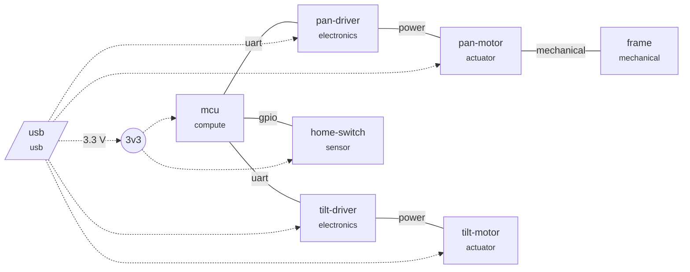

# Pan-Tilt Camera Mount

A desk mount that pans and tilts a small camera under USB control, for streaming and time-lapse photography.

**Current stage:** Architecture and interfaces  
**Build quantity:** 50  
**Parts cost:** $7.50/unit (target $45.00)

## Gates

| Stage | Gate | Errors | Warnings |
|---|---|---|---|
| Requirements | pass | 0 | 0 |
| Architecture and interfaces | BLOCKED | 1 | 0 |
| Power budget | pass | 0 | 0 |
| Parts and BOM | BLOCKED | 3 | 3 |
| Boards | BLOCKED | 1 | 0 |
| Enclosure and mechanics | pass | 0 | 2 |
| Firmware | BLOCKED | 1 | 0 |
| Certification | BLOCKED | 1 | 0 |
| Manufacturing and supply | BLOCKED | 2 | 1 |

## Architecture

## Power

| Rail | Volts | Peak mA | Avg mA | Limit mA | Fed from |
|---|---|---|---|---|---|
| 3v3 | 3.3 | 33.0 | 33.000 | 300 | usb |

Source **usb** (usb): peak 1443 mA, average 283.000 mA

## Bill of materials (priced at 50 units)

| Part | MPN | Category | Qty | Unit $ | Line $ | Price from | Suppliers | Lifecycle | Lead wks |
|---|---|---|---|---|---|---|---|---|---|
| mcu | EXAMPLE-MCU-USB | ic | 1 | 1.200 | 1.20 | typed | distributor-a, distributor-b | active | 2 |
| stepper-driver | EXAMPLE-STEPPER-DRV | ic | 2 | 2.100 | 4.20 | typed | distributor-a | nrnd | 10 |
| stepper-motor | TBD | motor | 2 | ? | ? |  |  |  |  |
| hall-sensor | EXAMPLE-HALL | sensor | 1 | 0.300 | 0.30 | typed | distributor-a, distributor-b | active |  |
| bearing | EXAMPLE-BEARING-6806 | mechanical | 1 | 1.800 | 1.80 | typed | bearing-vendor-a, bearing-vendor-b | active |  |
| **Total** | | | | | **7.50** | | | | |

## Certification checklist

_Starting checklist, not legal advice. Confirm with an accredited test lab._

| Item | Why | Plan |
|---|---|---|
| FCC Part 15 Subpart B | any digital electronics sold in the US (unintentional emissions) | **none yet** |

## Findings

### Architecture and interfaces
- **error**: interface mcu->home-switch (gpio): logic levels differ (3.3 V vs 5 V); add a level shifter and set level_shift: true

### Parts and BOM
- **warn**: part 'stepper-driver': lifecycle is nrnd; find a replacement before volume
- **warn**: part 'stepper-driver': single source (distributor-a)
- **error**: part 'stepper-motor': no manufacturer part number
- **error**: part 'stepper-motor': no price; run `ph parts` or set unit_cost_usd
- **warn**: part 'stepper-motor': lifecycle unknown
- **error**: part 'stepper-motor': no supplier with stock
- **info**: parts cost $7.50/unit at 50 units (target $45.00)

### Boards
- **error**: board 'ctrl': source hardware/ctrl not found

### Enclosure and mechanics
- **warn**: mechanical 'base': no CAD source yet
- **warn**: mechanical 'yoke': no CAD source yet

### Firmware
- **error**: firmware 'fw': path firmware not found

### Certification
- **error**: no plan for FCC Part 15 Subpart B (any digital electronics sold in the US (unintentional emissions))
- **info**: this list is a starting checklist, not legal advice; confirm with an accredited test lab

### Manufacturing and supply
- **error**: manufacturing.assembly missing: who builds the units (in-house, PCBA house, contract manufacturer)?
- **error**: manufacturing.pcb_fab missing: which board house
- **info**: longest part lead time: 10 weeks
- **warn**: manufacturing.test_plan missing: how is each unit tested before it ships?
