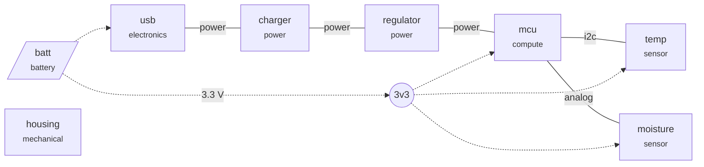

# Soil Sensor

A battery-powered stake that measures soil moisture and temperature in a garden bed and reports over Wi-Fi a few times an hour.

**Current stage:** Power budget  
**Build quantity:** 200  
**Parts cost:** $7.90/unit (target $18.00)

## Gates

| Stage | Gate | Errors | Warnings |
|---|---|---|---|
| Requirements | pass | 0 | 0 |
| Architecture and interfaces | pass | 0 | 0 |
| Power budget | BLOCKED | 1 | 0 |
| Parts and BOM | BLOCKED | 2 | 6 |
| Boards | BLOCKED | 1 | 0 |
| Enclosure and mechanics | BLOCKED | 1 | 0 |
| Firmware | BLOCKED | 1 | 0 |
| Certification | BLOCKED | 6 | 0 |
| Manufacturing and supply | BLOCKED | 2 | 1 |

## Architecture

## Power

| Rail | Volts | Peak mA | Avg mA | Limit mA | Fed from |
|---|---|---|---|---|---|
| 3v3 | 3.3 | 353.5 | 0.375 | 800 | batt |

Source **batt** (battery): peak 358 mA, average 0.406 mA, about 99 days

## Bill of materials (priced at 200 units)

| Part | MPN | Category | Qty | Unit $ | Line $ | Price from | Suppliers | Lifecycle | Lead wks |
|---|---|---|---|---|---|---|---|---|---|
| wifi-module | ESP32-C3-MINI-1-N4 | module | 1 | 2.927 | 2.93 | LCSC 2026-10-29 | LCSC | active |  |
| moisture-afe | LMV321IDBVR | ic | 1 | 0.069 | 0.07 | LCSC 2026-10-29 | LCSC | active |  |
| temp-sensor | SHT40-AD1B-R2 | sensor | 1 | ? | ? |  |  | active |  |
| charger-ic | TP4056 | ic | 1 | 0.058 | 0.06 | LCSC 2026-10-29 | LCSC | active |  |
| buck-boost | TPS63020DSJR | ic | 1 | 0.514 | 0.51 | LCSC 2026-10-29 | LCSC | active |  |
| usb-c-receptacle | TYPE-C-31-M-12 | connector | 1 | 0.128 | 0.13 | LCSC 2026-10-29 | LCSC | active |  |
| cell | EXAMPLE-LIION-1200 | battery | 1 | 2.900 | 2.90 | typed | cell-vendor-a, cell-vendor-b | active | 5 |
| passives | EXAMPLE-PASSIVE-KIT | passive | 1 | 0.400 | 0.40 | typed | distributor-a | active | 1 |
| pcb | EXAMPLE-PCB-2L | pcb | 1 | 0.900 | 0.90 | typed | fab-a, fab-b | active | 1 |
| **Total** | | | | | **7.90** | | | | |

## Certification checklist

_Starting checklist, not legal advice. Confirm with an accredited test lab._

| Item | Why | Plan |
|---|---|---|
| FCC Part 15 Subpart B | any digital electronics sold in the US (unintentional emissions) | pre-scan first prototype, then accredited lab |
| FCC modular grant reuse | pre-certified radio module: follow its integration rules and label 'Contains FCC ID' | follow module integration guide, label with module FCC ID |
| CE marking + Declaration of Conformity | any electrical product sold in the EU | compile technical file after RED testing |
| RoHS (EU) | restricted substances in electrical products | **none yet** |
| WEEE (EU) | take-back registration for electrical products | **none yet** |
| Radio equipment rules (EU, RED/RER) | radio product; covers EMC, safety and spectrum | **none yet** |
| Battery regulation (EU) | product contains a battery | **none yet** |
| UN 38.3 | shipping lithium cells or packs | **none yet** |
| IEC 62133-2 | lithium cell/pack safety, usually supplied by the cell vendor | **none yet** |

## Findings

### Power budget
- **info**: battery 'batt': average 0.406 mA, about 99 days
- **error**: battery life about 99 days, requirement is 180 days

### Parts and BOM
- **info**: part 'wifi-module': 13108 in stock (LCSC), $2.927 each at 200
- **warn**: part 'wifi-module': single source (LCSC)
- **info**: part 'moisture-afe': 139320 in stock (LCSC), $0.069 each at 200
- **warn**: part 'moisture-afe': single source (LCSC)
- **error**: part 'temp-sensor': no price; run `ph parts` or set unit_cost_usd
- **warn**: part 'temp-sensor': SHT40-AD1B-R2 not found at lcsc
- **error**: part 'temp-sensor': no supplier with stock
- **info**: part 'charger-ic': 357066 in stock (LCSC), $0.058 each at 200
- **warn**: part 'charger-ic': single source (LCSC)
- **info**: part 'buck-boost': 18252 in stock (LCSC), $0.514 each at 200
- **warn**: part 'buck-boost': single source (LCSC)
- **info**: part 'usb-c-receptacle': 303407 in stock (LCSC), $0.128 each at 200
- **warn**: part 'usb-c-receptacle': single source (LCSC)
- **info**: parts cost $7.90/unit at 200 units (target $18.00)

### Boards
- **error**: board 'main': source hardware/main not found

### Enclosure and mechanics
- **error**: mechanical 'housing': source mechanical/housing.py not found

### Firmware
- **error**: firmware 'fw': path firmware not found

### Certification
- **error**: no plan for RoHS (EU) (restricted substances in electrical products)
- **error**: no plan for WEEE (EU) (take-back registration for electrical products)
- **error**: no plan for Radio equipment rules (EU, RED/RER) (radio product; covers EMC, safety and spectrum)
- **error**: no plan for Battery regulation (EU) (product contains a battery)
- **error**: no plan for UN 38.3 (shipping lithium cells or packs)
- **error**: no plan for IEC 62133-2 (lithium cell/pack safety, usually supplied by the cell vendor)
- **info**: this list is a starting checklist, not legal advice; confirm with an accredited test lab

### Manufacturing and supply
- **error**: manufacturing.assembly missing: who builds the units (in-house, PCBA house, contract manufacturer)?
- **error**: manufacturing.pcb_fab missing: which board house
- **info**: longest part lead time: 5 weeks
- **warn**: manufacturing.test_plan missing: how is each unit tested before it ships?
